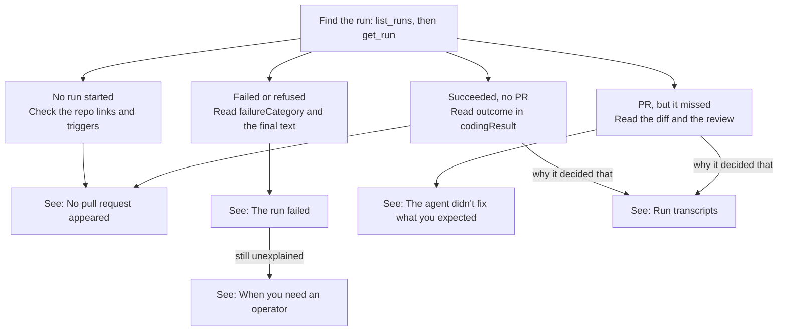

# Debugging an agent run

You can triage most agent problems yourself with the Wardby MCP and GitHub. Only
some failures need someone with server logs.

## Start here

Find the run with `list_runs`, then read it with `get_run`. Then go to the section
for what you see.



## What you can use without server access

These all work through the Wardby MCP or GitHub, and you only see runs you have
access to.

| Tool                                                                                                            | What it tells you                                                                                                                                                                                                                                                                                                                                                                        |
| --------------------------------------------------------------------------------------------------------------- | ---------------------------------------------------------------------------------------------------------------------------------------------------------------------------------------------------------------------------------------------------------------------------------------------------------------------------------------------------------------------------------------- |
| `list_runs` (agent id, optional `status`)                                                                       | An agent's recent runs: status, trigger, cost, turns, final text, and which run started it                                                                                                                                                                                                                                                                                               |
| `list_runs` without an agent id (from 0.8.0)                                                                    | Your runs across every agent, each with `agentName`; no final text. `active: true` or `since` (ISO time) narrow it                                                                                                                                                                                                                                                                       |
| `get_run` (run id)                                                                                              | One run in full, adding `failureCategory`, `diagnosticId`, `codingResult.outcome`, `request`, budget events and package refusals                                                                                                                                                                                                                                                         |
| `triggerInfo`, `outcomes`, `serviceReadiness` (from 0.8.0, on `get_run` and on `list_runs` without an agent id) | What started the run (the pull request and whether it was a review or a mention, the issue, the schedule or the lead), what it produced (pull requests opened, comments, checks) and each service's state, in the admin viewer API's shapes. Follow a pull request from the run that opened it through its review and fix rounds by matching one run's outcome to the next run's trigger |
| `get_agent`, `list_repositories`, `list_subagents`                                                              | How the agent is set up: prompt, model, budget, repo links and triggers, sub-agents                                                                                                                                                                                                                                                                                                      |
| `search_help`, `get_help_article`                                                                               | Help for an error code or failure category                                                                                                                                                                                                                                                                                                                                               |
| `cost_report`                                                                                                   | What runs cost, when spend is the question                                                                                                                                                                                                                                                                                                                                               |
| `get_run_steps` (from 0.9.0)                                                                                    | The run's steps, one line per tool call or model message, live while it runs; see [Run steps](#run-steps)                                                                                                                                                                                                                                                                                |
| `get_run_transcript`                                                                                            | The run's conversation, for Claude Code runs with `sessionResume` on                                                                                                                                                                                                                                                                                                                     |
| `stop_run`                                                                                                      | Stops a run that's stuck                                                                                                                                                                                                                                                                                                                                                                 |
| The PR, issue or Jira ticket                                                                                    | The diff, CI, the review, and the comment the run posted                                                                                                                                                                                                                                                                                                                                 |

From Wardby 0.8.0, `list_agents` with `summary: true` returns each agent's id,
name, kind, model, coding provider, budget, owner and your access, without the
prompt and coding profile. Admins (the `admin` role, `admin:view` scope) can add
`all: true` to `list_agents` or `list_runs` to see every agent or run in the
deployment.

Admins can also use the [Wardby Viewer](viewer-api.md), a desktop app showing runs,
sub-agent trees, triggers and outcomes for every owner.

## The run failed

Call `get_run` and read `status`, `error`, `failureCategory` and the final text. A
failed coding run's `error` looks like
`coding_failure_repo_access:coding_diag_…`: the middle part is the stage that
failed, and the ID is what an operator searches for.

| What you see                    | Likely cause                                              | What to do                                                           |
| ------------------------------- | --------------------------------------------------------- | -------------------------------------------------------------------- |
| `repo_access`                   | The agent's owner lost access, or a repo link was removed | Check `list_repositories` and the owner's GitHub access              |
| `repo_access_unavailable`       | GitHub couldn't be reached reliably                       | Try again later                                                      |
| `workspace`                     | Often a workspace disk size above the server's limit      | Lower `workspaceDiskMb`, or ask an operator to raise the limit       |
| `executor` while running checks | The run may have run out of memory, among other causes    | Reduce what the checks run; send the ID to an operator if it repeats |
| `merge_conflict`                | The branch conflicts with its target                      | Read the `merge-conflict` help article                               |
| `service_unready`               | A service the run needs, such as Postgres, didn't start   | Check `.wardby/services.yaml` and the agent's `services`             |
| `coding_turn_limit`             | The run used all its turns                                | Raise `maxTurns` or narrow the task                                  |
| `budgetEvents`, or `refused`    | The run, run tree or budget group ran out of money        | Raise the budget or check spend with `cost_report`                   |
| `packageRefusals`               | A package isn't allowed or is too new                     | Add it to `packageAllowlist`, or wait out the release age limit      |

For anything else, call `search_help` with the code or category. If that doesn't
explain it, see [When you need an operator](#when-you-need-an-operator).

**Prompt for Claude Code:**

```
Wardby run <run id> failed. Why, and what can I do about it?
If it needs server logs, give me the diagnosticId.
```

## No pull request appeared

First find out whether a run started, using `list_runs` on the lead or router,
then on the coding agent.

| What `list_runs` shows           | What it means                                                                                              | What to do                                                                                      |
| -------------------------------- | ---------------------------------------------------------------------------------------------------------- | ----------------------------------------------------------------------------------------------- |
| No new run                       | The request never started anything: nothing is linked with that trigger, or the person doesn't have access | Check `list_repositories` on the router. Only one agent per repo can hold the `mention` trigger |
| Lead ran, no coding run under it | The lead chose not to delegate                                                                             | Read the lead's final text, which should say why                                                |
| Coding run failed or was refused | See [The run failed](#the-run-failed)                                                                      |                                                                                                 |
| Coding run succeeded, with no PR | Check `codingResult.outcome` in `get_run`                                                                  | See below                                                                                       |

| `outcome`          | Meaning                                                                                                                                                 |
| ------------------ | ------------------------------------------------------------------------------------------------------------------------------------------------------- |
| `no_changes`       | The agent changed nothing. Its final text should say why: the request may be vague or already done. On Claude Code, the transcript shows how it decided |
| `budget_exhausted` | It ran out of money before finishing. Raise the budget or narrow the task                                                                               |
| `branch_pushed`    | A local repo: there's a branch, and no PR by design                                                                                                     |

A mention can also get no reply at all. If a server sets
`WARDBY_MENTION_EXPLANATIONS=false`, a mention that starts nothing stays silent. An
operator can look for `mention ignored` or `mention declined` in the server log.

**Prompt for Claude Code:**

```
I asked Wardby agent <agent name> to <request> in <your-org/your-repo>,
and no pull request appeared. Why?
```

## The agent didn't fix what you expected

The run succeeded, so most of what you need is on the PR and the run, with no
server logs involved. Check these in order:

1. **The diff:** what actually changed.
2. **The PR description:** the run's final text, including what it says it tested.
   If it says the tests weren't run, trust CI.
3. **The review:** whether your review check caught the miss.
4. **The request:** whether the issue or mention said what you meant.
5. **The task the agent received:** `request` in `get_run` (from Wardby 0.8.0). On a
   delegated run, this shows what the lead told the coding agent.
6. **The transcript:** why it decided that. This is only for Claude Code runs with
   `sessionResume` on.

The usual causes are a vague request, a lead that dropped something when it rewrote
the request, a repo rule missing from `AGENTS.md`, or a fix aimed at the symptom it
was told about.

**To fix it,** comment on the PR, mentioning the App, with what's wrong. The
follow-up pushes to the same branch and PR, so you don't start again. If the same
miss keeps happening, add the rule to `AGENTS.md` so future runs follow it.

**Prompt for Claude Code:**

```
PR <PR URL> from Wardby didn't do what I expected: <what you expected>.
Where did it go wrong? Draft a follow-up comment, but don't post it.
```

## Run steps

While a run runs, Wardby records its steps: one line for each tool call (the
tool, and its command, file or first argument, cut to about 100 characters) with
its status once the result is back (`ok`, `error`, or `exit N`), and one line for
what the model said (cut to about 120 characters). Tool output and full text are
never recorded. Steps are recorded for native runs (in the control plane and on
the native sandbox) and for Claude Code and Codex runs. A command shows as `Bash`
or the tool's own name (for example `exec_command`), and a remote MCP tool as
`mcp:<tool>`.

For Claude Code and Codex, the coding proxy reads the steps from the model's
replies after relaying them and posts them to the server's run-steps listener
(`POST /internal/run-steps`). A slow or unreachable listener loses steps, never
slows the run. Without the two settings in the table below, coding runs record no
steps; native runs are unaffected. Steps for a Claude Code or Codex run need the
listener, which only `wardby serve` runs.

**Reading them.** `get_run_steps` (`runId`, optional `after` and `limit`) lists
them oldest first, 50 at a time and at most 200; pass the last `seq` you have as
`after` to get only newer ones. `get_run` and `list_runs` without `agentId`
include `lastStep`, the newest step as one line. Access is the same as
`get_run`'s.

**Limits.** A run records at most 2,000 steps; `dropped` in `get_run_steps`
counts the rest.

**Secrets.** Every step is redacted before it is stored: every secret value of
the run's agent (attached secrets, readable or brokered, and its MCP servers'
secrets) is replaced with `[REDACTED]`, then anything shaped like a token or key.
If the agent's secrets can't be read at that moment, the step is not stored.

**Retention.** Steps are deleted `RUN_STEP_RETENTION_DAYS` after they are
recorded. The scheduler leader deletes expired steps at most every ten minutes. `get_run_steps` reports
`expired` when a run finished more than `RUN_STEP_RETENTION_DAYS` ago and has no
steps left.

| Variable                  | Read by                                                                                 | Default   | Meaning                                                                                                                                                                                          |
| ------------------------- | --------------------------------------------------------------------------------------- | --------- | ------------------------------------------------------------------------------------------------------------------------------------------------------------------------------------------------ |
| `WARDBY_RUN_STEPS`        | `wardby serve`, `wardby scheduler`, `wardby run`, `wardby mcp`, `wardby native-gateway` | `summary` | `off` records nothing; `summary` records the lines above. `detail` is accepted and recorded as `summary` in this release. Any other value stops start-up.                                        |
| `RUN_STEP_RETENTION_DAYS` | `wardby serve`, `wardby scheduler`, `wardby run`, `wardby mcp`, `wardby native-gateway` | `30`      | Days to keep a step, a whole number from 1 to 3650. A change applies to steps recorded after it. Any other value stops start-up.                                                                 |
| `WARDBY_RUN_STEPS_LISTEN` | `wardby serve`                                                                          | unset     | `host:port` or `:port` of the run-steps listener the coding proxy posts coding runs' steps to. Unset: no listener. An invalid value stops start-up.                                              |
| `WARDBY_RUN_STEPS_URL`    | the coding proxy                                                                        | unset     | The listener's origin, for example `http://<server host>:8792`: `http` or `https`, no credentials, path, query or fragment. Unset: coding runs record no steps. An invalid value stops start-up. |

The coding proxy also reads `WARDBY_RUN_STEPS`: with `off`, or with
`WARDBY_RUN_STEPS_URL` unset, no step text leaves the proxy. The listener is a
second network path into the server; see
[Run steps in Security deployment](security-deployment.md#run-steps) for how to
restrict it.

**Upgrading.** The release adds the `RunStep` table and the `Run.stepsDropped`
column; apply the migration with `prisma migrate deploy` as with any upgrade.

## Run transcripts

A transcript is the run's conversation: the messages, the tool calls and their
results, and the files and skills the agent loaded. You can get it yourself,
without server access, on Claude Code agents.

**To turn it on,** set `codingProfile.sessionResume` to `true` with `update_agent`.
It's off by default and has to be turned on for each agent. It only applies to runs
started afterward, so an earlier failure has no transcript. The server also needs a
blob store, set in the environment of the process that launches coding runs:
`BLOB_STORE` set to `local`, `gcs` or `s3`, plus `BLOB_STORE_LOCAL_DIR`,
`BLOB_STORE_GCS_BUCKET`, or `BLOB_STORE_S3_BUCKET` and `BLOB_STORE_S3_REGION`.
Without `BLOB_STORE`, no transcript is stored.

**To read one,** call `get_run_transcript` with the run ID. It returns a download
link that works for 10 minutes and a command. Run `npx @wardby/cli@latest resume -`
in a clone of the repo and paste the link, which also lets you continue the session
on your machine.

| Transcripts        |                                                                                |
| ------------------ | ------------------------------------------------------------------------------ |
| **Who can read**   | Anyone who can read the run: the person who triggered it and the agent's owner |
| **Stored for**     | Runs that finish, fail, or stop at their budget                                |
| **Not stored for** | Runs stopped with `stop_run` or ended by their timeout                         |
| **Removed**        | Thinking blocks, the system prompt, the worker's environment, account details  |
| **Redacted**       | The agent's attached secrets and the run's own tokens                          |
| **Not available**  | On Codex agents                                                                |

Redaction removes secret values, not other sensitive text, so a transcript includes
what the agent saw in the repo and in command output. Turn this on only for agents
whose runs you're comfortable sharing with everyone who can read them.

**Prompts for Claude Code:**

To turn it on:

```
Turn on transcripts for Wardby agent <agent name>.
```

To get one:

```
Get me the transcript for Wardby run <run id>.
```

See [Resume Claude Code runs locally](../help/resume-runs-locally.md) for more.

## When you need an operator

Ask someone with server access when `get_run` and help don't explain a failure. The
specific reason for a failed coding run is written only to the server log, under
its `diagnosticId`.

**Send them:** the run ID, the `diagnosticId`, the repo, and what you expected to
happen.

**What the operator can do:**

1. Search the control-plane log for the `diagnosticId`, which holds the real reason.
2. If that isn't enough, turn on the
   [debug trace](coding-worker-isolation.md#debug-trace) with `debugTraceMinutes`
   and reproduce the failure.

The debug trace won't help you directly. Only admins can turn it on, it only covers
runs started afterward, and its output goes to the run's worker log, which you can't
read. It can include prompts and repo content, so it isn't exposed through MCP.

**What the trace holds:** the agent's whole stream, the commands it ran with their
output (Claude Code), final usage and duration, and stream failures in full.
Token-shaped values are redacted. It stops at 2 MiB per run by default.

**What MCP gives you:** the trace itself isn't available through MCP. You can only
turn it on or off with `update_agent` (admin role), see when it expires with
`get_agent` (`debugTraceUntil`), and see whether a run was traced with `get_run`
(`debugTrace: true`).

**Prompt to try first.** Paste this into any client connected to the Wardby MCP:

```
Wardby run <run id> didn't do what I expected. What happened, and what can I do?
If it needs server logs, give me the diagnosticId.
```

## Known gaps

Two things can't be answered without server access yet.

| Gap                                     | Why it matters                                                       | What you can do                                                     |
| --------------------------------------- | -------------------------------------------------------------------- | ------------------------------------------------------------------- |
| The specific reason a coding run failed | You get the stage, such as `executor`, but not why                   | Send the `diagnosticId` to an operator                              |
| Why a mention got no reply              | With explanations off, a declined mention leaves no reply and no run | Turn explanations on where that's acceptable: `true` is the default |

**To turn explanations on,** an operator removes
`WARDBY_MENTION_EXPLANATIONS=false` from the server's settings, or sets it to
`true`, then redeploys. Once on, the GitHub App replies to say why a mention started
nothing. On a public repo, anyone who can read that comment can see what is or isn't
linked there.

Run transcripts are limited to Claude Code runs with `sessionResume` on, so they
don't help on Codex agents.
